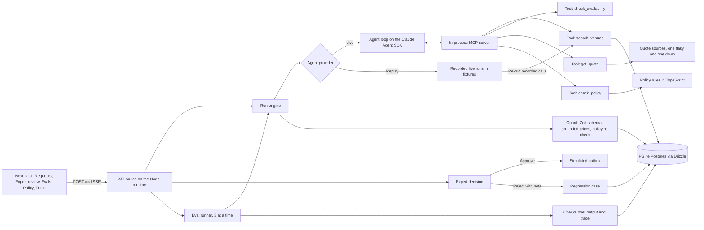
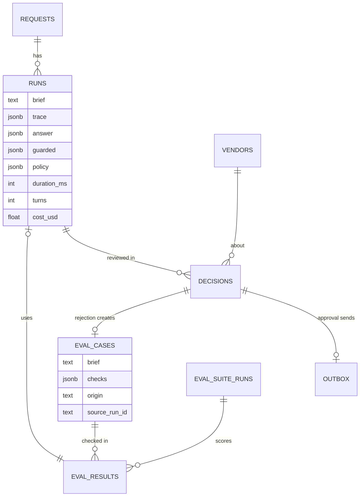

# Venue Sourcing Desk

A sourcing desk for corporate events: an agent shortlists venues within company policy, an event expert approves or rejects each offer, and a rejection with a note becomes a regression test.


Full video: https://github.com/ArchiusVuong-sudo/venue-sourcing-desk/releases/download/v0.1/demo.mp4

All data is synthetic: every venue, price, CO2 figure and company in this repo is invented. The workspace is a fictional "Demo Co.". I built this prototype for a job application; it has no users.

## What it does

- A planner types an event request in plain words ("40 people, 2 nights in May, somewhere warm by the sea, EUR 60k, 6 vegetarian, 1 wheelchair user") and watches the agent work step by step: venue search, date checks, quotes and policy checks.
- The agent returns a shortlist of 2-3 comparable offers with total and per-guest price, capacity fit, travel mode and time, illustrative CO2 per guest, step-free and policy badges, and one drafted RFP (request for proposal).
- Every price on screen equals a quote returned in that run. A flaky quote source is retried with backoff, and a source that stays down shows "quote unavailable", never a guessed number.
- Nothing reaches a venue until an event expert approves it. Approve, edit the RFP, or reject with a note per offer; approved RFPs go to a simulated outbox.
- A rejection can be saved as a regression case. The Evals page runs every case (3 at a time) with checks in code over the output and the tool trace, and shows pass rate, p50 latency and estimated cost next to the previous suite run.
- Every run has a trace: model turns and tool calls with inputs, outputs, latency, tokens and the SDK's cost estimate.

## Architecture



Data model:



## How it works

**Agent.** One Claude Agent SDK query per run (`src/lib/agent/live.ts`). The agent gets no built-in Claude Code tools (`tools: []`), only 4 tools from an in-process MCP server, listed in `allowedTools` with `permissionMode: "dontAsk"`, so it cannot use anything else. It runs with `settingSources: []`, `strictMcpConfig`, `persistSession: false`, a fresh temp working directory, a 14-turn cap and a child environment built from an allowlist (PATH, HOME, USER, LANG, TMPDIR, ANTHROPIC_API_KEY). The answer comes back as structured output from a Zod 4 schema (`z.toJSONSchema`) and is parsed again with Zod on our side.

**Tools.** `search_venues` applies hard filters in SQL (capacity, bedrooms, breakout rooms, step-free, coastal, travel mode, region) and ranks the rest with Postgres full-text search over the descriptions. `check_availability` reads blackout dates. `get_quote` prices a request from the venue's rate card; one hotel chain's source times out on its first call in a run and one venue's source is always down, and the tool retries with exponential backoff before it answers "unavailable". `check_policy` evaluates the run's own quote against the company policy. Every call, live or replayed, goes through one function that validates input with Zod (strict, so unknown keys fail) and records a trace step.

**Guardrails in code.** After the run, a guard re-checks every offer: the venue must be in the catalog, the quote id must have been returned in this run with the same total and per-guest price, and the policy is evaluated again instead of trusting the model. Offers that fail are removed and shown as removed, with the reason. The agent has no tool that contacts a vendor: sending is a separate code path that runs only on an expert's approval.

**Evals.** 6 seeded cases are written like an expert's tickets: a Munich kick-off with 120 guests and 4 breakouts, a 14-person Berlin retreat, a Lisbon offsite with no dates or budget (the agent must ask), a Leipzig workshop with a cheap blocked vendor as a trap, a Hamburg board meeting with the failing quote source, and a Brandenburg offsite with a wheelchair user and dietary counts. Checks are deterministic TypeScript over the structured output and the tool trace: budget, headcount, breakout rooms, blocked vendors, grounded prices, step-free access, dietary counts in the RFP, a question when details are missing, no flight destinations. Every case that expects a shortlist also checks "at least 2 priced offers", so an empty answer or a question cannot pass a "no X in the shortlist" check. The checks score the raw answer, not the guarded one, so a prompt or model change that starts proposing blocked options turns red even though the guard would hide it.

**The loop.** The expert rejects a flight option for a 2-night offsite with "no flights for short offsites" and saves it as a case with the check "No flight destinations". The case shows its source run failing that check, computed from the stored run. Turning on "No flights for events of 3 days or fewer" on the Policy page makes `check_policy` block flight destinations, the agent proposes the rail-reachable Baltic coast with the trade-off said plainly, and the next suite run turns the case green.

**Replay mode.** One provider interface, two implementations. Live uses the SDK. Replay plays back a recorded live run from `fixtures/`, keyed by the request text and the parts of the policy that change the answer. It replays the model's turns, but every tool call runs again through the real tools, so quotes, retries, policy results and checks are computed now. Replay shows its latency, tokens and cost as recorded. A request with no recording fails with a plain message; it never makes up an answer.

**Decisions and trade-offs.**
- PGlite gives real Postgres (full-text search, jsonb) in process with no server to run; one instance per process. A hosted Postgres only needs a different Drizzle driver.
- Runs and suites are in-process background jobs with an in-memory registry for SSE. That keeps the demo one process; it does not survive a restart, and a leftover running suite is closed as stopped on the next start.
- Checks are deterministic rather than model-graded, so a red result always has a reason you can read and reproduce.
- Cost comes from the SDK's `total_cost_usd` and is labelled "est.": the SDK calls it an estimate, not a bill.
- Over the EUR 20k threshold shows as a reason (budget-owner sign-off), not a second approver: in the demo the expert's approval covers it.

## Run it

Requires Node 20.9 or newer.

```bash
npm ci
npm run build
npm start                 # http://127.0.0.1:4108
```

- Live mode is used when a Claude Code login (`claude login`) or `ANTHROPIC_API_KEY` is present. A run takes about 20-40 s.
- Replay mode needs no login or key: `DEMO_REPLAY=1 npm start`. A "Replay mode" badge shows in the header. The example requests and every eval case are recorded under both settings of the no-flights rule.
- Development server: `npm run dev`.
- Record fresh fixtures from live runs (14 runs, 3 at a time): `npm run record`. `RECORD_FIXTURES=1 npm start` also saves every live run as a fixture.
- One live run printed step by step: `npm run smoke`.

Environment variables (see `.env.example`):

| Variable | Default | Meaning |
| --- | --- | --- |
| `PORT` | `4108` | Port for `npm start` and `npm run dev`, bound to 127.0.0.1 |
| `DEMO_REPLAY` | unset | `1` forces replay mode |
| `AGENT_MODEL` | `claude-sonnet-5-5` | Model for live runs, for example `claude-opus-5-5` or `claude-haiku-5-5` |
| `ANTHROPIC_API_KEY` | unset | Optional; otherwise the local Claude Code login is used |
| `DATA_DIR` | `.data/pglite` | PGlite data folder, or `memory://` |
| `RECORD_FIXTURES` | unset | `1` saves each live run to `fixtures/` |
| `REPLAY_SPEED` | `0.4` | Replay pacing; `0` is instant |

To start over, stop the app and delete `.data/`.

## Tests

```bash
npm test          # Vitest, replay mode, no network
npm run typecheck
npm run lint      # Oxlint
LIVE=1 npm run test:live   # opt-in: one real agent run
```

- Unit tests cover quote math and its limits, every policy rule, every eval check (including that no shortlist check passes on an empty answer), the tools (input validation, unknown keys, full-text search with stop-word queries, blackout dates, the retry with backoff, the always-down source), the guard, the replay fixtures and the SDK isolation options.
- An end-to-end test runs the main flow in replay mode through the same services and route handlers the pages use: request, shortlist, rejection to regression case, approvals to the outbox, a suite run where the new case fails, the policy change, and a suite run where all 7 pass.
- `scripts/walkthrough.ts` drives the built app in a headless browser through the same flow and saves a 1440x900 screenshot of each screen.

## Notes

- Synthetic data only: 31 invented venues in Berlin, Brandenburg, the Baltic coast, Leipzig, Hamburg, Munich, the Lisbon coast and Mallorca. Prices come from invented rate cards; CO2 factors are illustrative round numbers.
- Limits: one process, in-memory job registry, no auth or roles, one policy, one currency. Replay covers the recorded requests only.
- A production version would put each agent run and each eval case in a durable background job (Trigger.dev tasks, with a waitpoint for the expert's approval), use hosted Postgres with the same Drizzle schema, and move the API to typed tRPC procedures.
- It would also add per-tenant policies and approval thresholds, real vendor integrations behind the approval step, Redis for run events across instances, and an eval set grown from production rejections with a CI gate on the pass rate.
